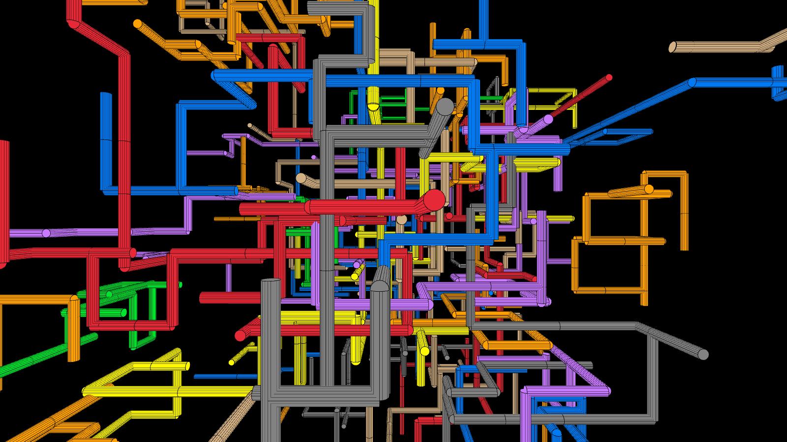
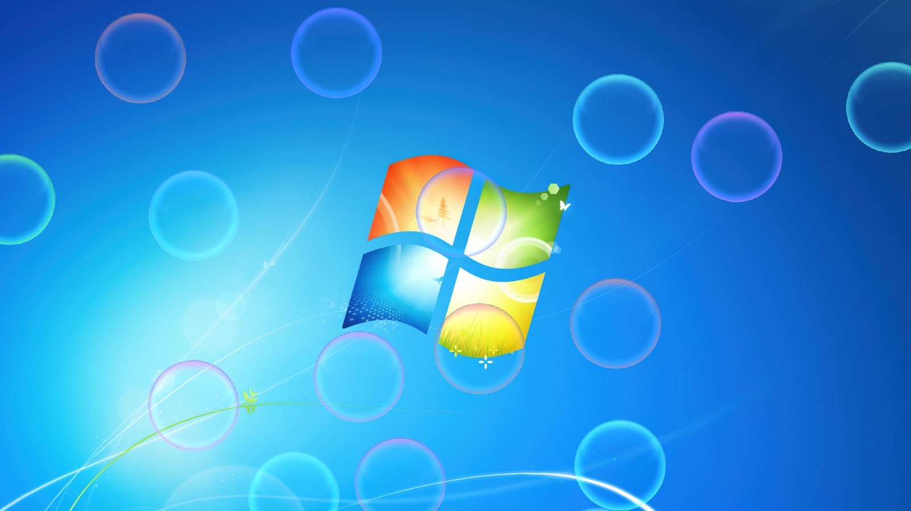

# ScreenSaver

A cross-platform collection of classic screensavers built with raylib. One executable, three nostalgic modes:

    Pipes — the Windows 95-style 3D pipes screensaver

<div align="center">
    
</div>

    Bubbles — the Windows 7+ style floating bubbles with collision and color blending

<div align="center">
    
</div>

    DVD — the endlessly bouncing DVD logo

Made by @mahanfr.

## Features

- Pipes: randomly generated, continuously growing 3D pipes that bend in random directions on a black background.

- Bubbles: physics-based bubbles that float upward, bounce off the screen edges, collide with each other, push apart, and smoothly shift hue when they touch.

- DVD logo: the classic bouncing logo that changes color every time it hits a screen edge.

- Transparent window support for the bubbles and dvd modes.

- Borderless fullscreen by default, with the mouse cursor hidden — just like a real screensaver.

- Switch between modes at runtime with the Up/Down arrow keys.

- Cross-platform: builds on Linux and Windows (MSVC or MinGW).

## Requirements

- CMake ≥ 3.20

- A C99 compiler

- raylib static library for your target platform

- Linux: OpenGL, X11, pthread, dl, rt, m

The build expects the raylib static libraries to be placed in the following directories (relative to the project root):

Platform	Library path

Windows / MSVC	libs/raylib/win32-msvc/raylib.lib

Windows / MinGW	libs/raylib/win32-mingw/libraylib.a

Linux	libs/raylib/linux/libraylib.a

## Building

### Linux
```bash

cmake -S . -B build
cmake --build build
```

### Windows (MSVC)
```bash

cmake -S . -B build
cmake --build build --config Release
```

### Windows (MinGW cross-compile)
```bash

cmake -S . -B build -DMINGW=ON
cmake --build build
```
The resulting binary is screensaver (screensaver.exe on Windows).

## Usage
```bash

screensaver <command>

Command	Description
pipes	Windows 95-style pipes screensaver
bubbles	Windows 7+ bubbles screensaver (transparent window)
dvd	Bouncing DVD logo (transparent window)
```

Running screensaver with no arguments prints the help text and starts in pipes mode.

## Controls

Key	Action

Up	Switch to the next mode

Down	Switch to the previous mode

Esc	Close the window / exit

Note: The transparent window background is chosen at startup. Switching to bubbles or dvd after launching another mode will keep the opaque background — restart the program with the desired mode to get transparency.

## Implementation Notes

- DVD mode re-tints a copy of the original logo image on every wall hit and uploads it to the GPU as a texture; the image is reloaded from the pristine copy each time.

- Bubbles mode spawns a new bubble roughly once per second (up to 30). Bubbles use impulse-based collision resolution with positional correction and a small tangential jitter, and rotate their hue toward a randomly chosen target hue at 90°/s.

- Pipes mode builds up to 80 pipes, each with up to 20 bends. Bends grow at 80 units/second in one of the six cardinal directions; when the pipe list is full, it is reset and generation starts over.

- The camera for pipes mode is fixed at (0, 0, 18) looking at the origin with a 60° perspective FOV.

## License

This project is provided as-is by its author. See the repository for licensing information or contact @mahanfr.
